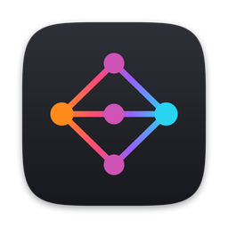

# NAM2Nano

A native macOS utility (SwiftUI, macOS 14+) that re-captures **Neural Amp Modeler (`.nam`)** models
into the **Neural DSP Nano Cortex**, using the pedal itself as the USB audio interface and a single
`OUT 1L → CAPTURE IN` patch cable. A 6-step wizard: USB → Bluetooth → cabling → `.nam` file →
metadata → capture.



## Build (macOS)

```bash
brew install xcodegen
./Scripts/bootstrap.sh          # clones NeuralAmpModelerCore (pinned commit) + Eigen, generates the project
open NAM2Nano.xcodeproj         # Run the NAM2Nano scheme
```

Requirements: Xcode 15+ (Swift 5.9+), macOS 14 Sonoma. No App Sandbox; hardened runtime with
`audio-input` (macOS treats the Nano's USB audio as a "microphone", so grant access on first launch).

Offline test of the C++ engine (also runs on Linux):

```bash
Tools/engine_test/build.sh                      # uses the ThirdParty/ copy created by bootstrap
Tools/engine_test/build/engine_test path/to/*.nam
```

It checks: the 48k↔44.1k/96k resampler (0.00 dB gain, SNR > 84 dB, zero jitter), pink-noise
calibration, loading/processing of every `.nam` passed in (A1, A2, LSTM, Slimmable, condition DSP),
zero underruns, and model hot-swap while rendering (also clean under ThreadSanitizer).

## Architecture

| Area | File | Notes |
|---|---|---|
| App / state machine | `App/AppState.swift`, `App/AppSettings.swift` | `@Observable`; a step unlocks only after its check passes |
| USB / CoreAudio | `Core/Audio/AudioDeviceMonitor.swift` | `kAudioHardwarePropertyDevices` listener, forces 48 kHz |
| Audio engine | `Core/Audio/NanoAudioEngine.swift` | one full-duplex AUHAL on the Nano; RT callback with no ARC/allocations |
| DSP | `Core/NAM/Engine/NAMEngine.{hpp,cpp}` | pure C++: source → input trim → (resample) → NAM → (resample) → output trim → clip guard |
| Resampling | `Core/NAM/Engine/StreamingResampler.hpp` | Kaiser-windowed sinc, 32 taps, RT-safe |
| Bridge | `Core/NAM/NAMProcessorBridge.{h,mm}` | Obj-C++ facade for Swift |
| `.nam` parser | `Core/NAM/NAMParser.swift` | WaveNet/LSTM/ConvNet/Linear/Sequential/SlimmableContainer, A1 vs A2 |
| BLE | `Core/Bluetooth/NanoBLE{Manager,Protocol}.swift` | GATT A002/A003, C304 write, C305 notify, minimal protobuf |
| Calibration | `Core/Audio/SignalCalibrator.swift` | cable continuity test, CAPTURE IN auto-level, gain staging |
| Capture | `Core/Capture/CaptureSession.swift` | capture mode → auto-level → training → save (+slot) → play mode |
| UI | `Views/…` | wizard, animated vector diagrams (Canvas), meters, BLE/Audio monitors (Debug menu) |

### Audio flow during a capture

```
Nano: test signal on OUTPUT 2R (CAPTURE OUT) ──USB In 4──▶ Mac: NAM (NeuralAmpModelerCore)
Mac ──USB Out 1──▶ Nano OUTPUT 1L ──TS cable──▶ CAPTURE IN ──▶ capture training on the Nano
```

Channels are configurable in **Settings (⌘,)**; **Debug → USB Audio Monitor** shows the level of
every input so you can find the right one. If the chosen channel stays silent after the capture
starts, the app can switch to the loudest other input automatically (never the one mirroring OUT 1L).

## ⚠️ To verify on real hardware

Nothing has been tested on a pedal yet. Known uncertainties:

1. **BLE protocol.** Taken from the open-source project
   [DrD85/nano-cortex-editor](https://github.com/DrD85/nano-cortex-editor) (MIT). The capture messages
   (73 enter, 26 gain, 39 start, 40/41 progress/done, 93 sanity, 13/14 save, 80/81 slot) were decoded
   from Cortex Cloud 2.8.3 traffic and **have not been confirmed on hardware by their author**. The
   `grliszas14/NanoDesk` repo referenced by the plan has no public source. The advertised BLE name is
   undocumented (matched with `/nano|cortex/i`). Use **Debug → BLE Monitor** (⌘⇧B) to log packets
   and send raw hex frames.
2. **USB routing.** Neural DSP documents 4 in / 3 out (In 1 dry, In 3/4 processed OUTPUT 1L/2R);
   other sources report 8 channels. Still to confirm: that the test signal arrives on In 4 in capture
   mode, and that USB playback comes out of OUTPUT 1L.
3. **Feedback risk.** If OUTPUT 1L monitors CAPTURE IN in capture mode, the cable forms a loop. The
   step 3 test detects this (signal that does not decay after the tone stops) and reports it.
4. **USB dBu reference** (for `input_level_dbu` calibration): assumed 12 dBu, editable in Settings.
5. **Capture name length:** minimum 4 characters (as in the editor), conservative maximum of 32.

## Deviations from PLAN.md

See the "Implementation status" section of [PLAN.md](PLAN.md).

## Icon

`Tools/generate_icon.py` (Pillow only) regenerates `AppIcon.appiconset`: a flat 1→3→1 neural network
with an orange→violet→cyan gradient on graphite.

## Licenses

NeuralAmpModelerCore © Steven Atkinson (MIT). BLE protocol based on the work of nano-cortex-editor
(MIT). Neural DSP and Nano Cortex are trademarks of their respective owners; this project is not
affiliated with them.
